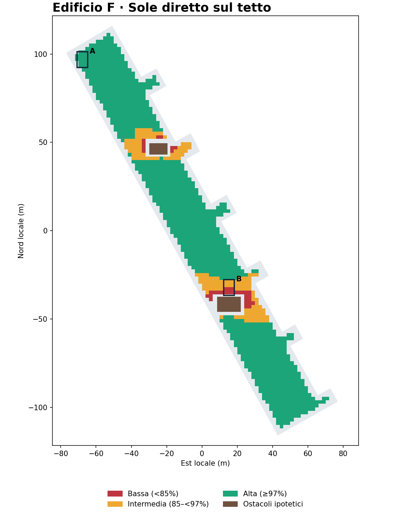

# ☀️ Roof to Solar

**Dal modello IFC dell’Edificio F a una web app che aiuta a scegliere dove installare i pannelli fotovoltaici.**

Sul tetto dell’Edificio F dell’Università di Salerno, due gruppi identici di pannelli ricevono quantità diverse di luce. La ragione si vede sulla mappa: uno dei due gruppi si trova più vicino agli ostacoli. *Roof to Solar* parte da questa osservazione per rispondere a tre domande: **dove posizionare i pannelli, quanti installarne e come orientarli?**

🟢 **GeoLibre** · analisi del tetto e dell’esposizione  
🔵 **PVGIS** · stima della produzione fotovoltaica  
🟠 **Web app** · progettazione e confronto degli scenari

---

## 🟢 Il caso studio · Edificio F, campus di Fisciano

Siamo partiti da un **modello IFC dimostrativo dell’Edificio F**, integrato con la sagoma della copertura e un modello digitale della superficie. Sul tetto sono stati rappresentati due volumi tecnici ipotetici per studiare l’effetto delle loro ombre.

Per capire quanto contasse la **posizione**, abbiamo scelto due zone del tetto: **A**, più lontana dagli ostacoli, e **B**, più vicina. In entrambe abbiamo collocato **12 moduli da 450 Wp**, rivolti a sud e inclinati di 15°. Mantenere invariati pannelli, potenza e orientamento ci ha permesso di confrontare le due posizioni a parità di condizioni.

*Figura 1 · La mappa permette di individuare dove gli ostacoli riducono il tempo di esposizione al sole. Due punti sullo stesso tetto possono quindi offrire condizioni di posa diverse.*

## 🟡 Primo risultato · Dove conviene installare i pannelli?

Abbiamo confrontato il tempo al sole, le ombre e la produzione prevista nelle due zone. GeoLibre ha permesso di esplorare le differenze sulla copertura; i profili di orizzonte usati in PVGIS e una simulazione annuale separata hanno permesso di valutarne l’effetto sulla produzione.

| Indicatore | Zona A | Zona B |
|---|---:|---:|
| Sole diretto medio per modulo il 21 dicembre | **9,00 ore** | **2,78 ore** |
| Produzione annua stimata con PVGIS per un modulo rappresentativo da 450 Wp | **603,78 kWh** | **535,98 kWh** |
| Produzione annua dei 12 moduli in una simulazione separata | **7.699,11 kWh** | **6.467,81 kWh** |

**La zona A è risultata più favorevole.** Il 21 dicembre, ogni modulo ha ricevuto in media **6,22 ore di sole diretto in più**. Per il singolo modulo rappresentativo, PVGIS ha stimato in B una produzione inferiore dell’**11,2% rispetto ad A**. La simulazione dei 12 moduli, che considera le ombre sull’intera disposizione, ha stimato una riduzione di circa il **16%**.

## 🔵 Secondo risultato · Sud oppure Est–Ovest?

Una volta scelta la **zona A**, abbiamo cambiato la domanda: a parità di posizione e di potenza installata, quale orientamento produce più energia nell’arco dell’anno?

| Configurazione | Disposizione | Potenza | Produzione annua stimata con PVGIS |
|---|---|---:|---:|
| **Sud** | 12 moduli rivolti a sud | 5,4 kWp | **7.245,66 kWh** |
| **Est–Ovest** | 6 moduli rivolti a est e 6 a ovest | 5,4 kWp | **6.456,10 kWh** |

**Nelle condizioni studiate, il sud offre circa 790 kWh in più all’anno**, pari al **12,2% in più rispetto a Est–Ovest**. Il risultato riguarda l’energia annua delle due configurazioni analizzate a Fisciano; per un altro edificio il confronto va ripetuto con i dati del sito.

*Figura 3 · Il profilo invernale illustra come cambia la distribuzione della produzione durante la giornata. Il grafico proviene da una simulazione giornaliera separata; i totali annui della tabella provengono da PVGIS.*

---

## 🟠 Dal caso studio al tuo tetto

La web app contiene due ambienti. **Edificio F** presenta il caso studio e permette di esplorare le configurazioni analizzate. **Progetta sul tuo tetto** porta lo stesso tipo di ragionamento su un edificio scelto dall’utente. Per iniziare basta selezionare una sagoma sulla mappa o tracciare il perimetro della copertura. Chi dispone già di un poligono può importarlo in formato GeoJSON.

| Voce del menu | Cosa può fare l’utente |
|---|---|
| **Disegna zona** | Delimitare una porzione del tetto da destinare ai pannelli, oppure utilizzare l’intera copertura. |
| **Esposizione** | Posizionare gli ostacoli conosciuti, come un camino, e visualizzare quali parti del tetto ricevono più sole nel periodo analizzato. |
| **Consigliami un impianto** | Chiedere una proposta automatica oppure indicare il numero di pannelli desiderato e vederne la posizione sulla planimetria. |
| **Previsione** | Consultare il numero di moduli, la potenza installata in kWp e la produzione annua di riferimento quando sono disponibili i dati PVGIS. |
| **Confronto A/B** | Affiancare due scenari, confrontarne i risultati e stampare il riepilogo o salvarlo in PDF. |

### Come vengono scelti i pannelli?

Con **«Consigliami tu»** l’app confronta **16 possibili disposizioni**. Tra quelle provate, privilegia la disposizione che ospita più moduli con almeno il **95% di tempo medio al sole** nel periodo della mappa. I pannelli consigliati appaiono in **verde**; i contorni **grigi** indicano ulteriori posti disponibili nella stessa griglia.

Con **«Scelgo io il numero»**, la decisione parte invece dall’utente. Per esempio: *«Vorrei installare 7 pannelli: dove li metto?»*. L’app cerca una disposizione che accolga i sette moduli nelle posizioni più esposte tra quelle provate. Se riesce a collocarne soltanto cinque, mostra i cinque posti trovati.

> [!NOTE]
> **Tempo al sole ed energia prodotta sono due misure diverse.** Il 95% indica la quota di tempo diurno in cui la superficie del modulo riceve sole diretto nel periodo analizzato. Non significa che il pannello abbia un rendimento del 95%. Nel laboratorio, la stima annua di riferimento di PVGIS non viene corretta automaticamente per le ombre locali disegnate dall’utente.

## 🟣 Perché è utile per l’utente finale

- **Capire dove conviene installare.** La proposta è visibile sul tetto: l’utente può riconoscere un ostacolo e osservare perché il sito preferisce alcune posizioni ad altre.
- **Distinguere lo spazio disponibile da quello ben esposto.** Un pannello può entrare fisicamente in una zona che rimane in ombra per una parte rilevante della giornata. La mappa rende visibile questa differenza.
- **Confrontare alternative prima di decidere.** L’utente può provare un numero diverso di moduli, limitare l’area di posa o confrontare due configurazioni osservandone gli effetti.
- **Partire da informazioni semplici.** Non serve possedere un modello IFC del proprio edificio. Il contorno del tetto e gli ostacoli conosciuti sono sufficienti per una prima esplorazione da approfondire con un tecnico.

## 📦 Contenuto della repository

| Cartella | Materiali disponibili |
|---|---|
| `sito/` | Web app, mappe interattive, dati del caso studio, proposta di posa, confronto degli scenari e server locale. |
| `geolibre/` | Modello IFC dimostrativo, modelli 3D, dati del terreno, raster di esposizione e poligoni delle zone A e B. |
| `geolibre/Edificio_F_Kit_Potenziale_Solare/` | Modello digitale della superficie a 1 m, maschera della copertura e area candidata alla posa. |
| `geolibre/Fotovoltaico_Edificio_F_GeoLibre/` | Ostacoli, griglia di esposizione, mappa del tetto e modelli delle due disposizioni dei pannelli. |
| `geolibre/Edificio_F_Confronto_Ombre_AB_Annuale/` | Dati meteorologici orari, script di calcolo, risultati numerici e grafico mensile delle zone A e B. |
| `geolibre/Edificio_F_Confronto_Sud_Est_Ovest/` e `geolibre/Orizzonti_PVGIS_Edificio_F_AB/` | Configurazioni di orientamento, profilo invernale e orizzonti personalizzati per i moduli rappresentativi. |
| `geolibre/Campus_UNISA_3D_kit/` | Terreno del campus, modelli dei singoli piani e vista esplosa dell’Edificio F. |
| Altre cartelle in `geolibre/` | Analisi complementari sul drenaggio, sui percorsi di deflusso intorno all’edificio e sulla ritenzione delle precipitazioni negli scenari di tetto verde. |
| `documentazione/` | Presentazione, relazioni tecniche e appunti con il procedimento, le ipotesi e i risultati. |

## 🚀 Come avviare l’app

1. Scarica o clona la repository. Per utilizzare il laboratorio completo è necessario **Python 3**.
2. **Su Windows**, apri `sito/Avvia_Laboratorio.cmd` e lascia aperto il prompt durante l’utilizzo. **Da terminale**, in alternativa, esegui `python3 sito/server_atlante.py` dalla cartella principale.
3. Il server apre l’app nel browser. Per una prima prova scegli **Progetta sul tuo tetto → Prova un esempio offline → Conferma questa copertura**.
4. Seleziona **Esposizione → Calcola esposizione**, poi **Consigliami un impianto → Mostra proposta** per vedere i pannelli sulla planimetria.

Le mappe online e le richieste a PVGIS richiedono una connessione Internet. Il laboratorio completo utilizza un server Python; la sola pubblicazione delle pagine statiche su GitHub Pages non ne esegue i calcoli.

> [!IMPORTANT]
> Il modello dell’Edificio F e gli ostacoli sono ricostruzioni a scopo didattico. I valori riportati sono risultati di simulazioni, non misure di un impianto in esercizio. L’app supporta il confronto preliminare delle soluzioni; la progettazione esecutiva richiede il rilievo e la verifica tecnica della copertura.
